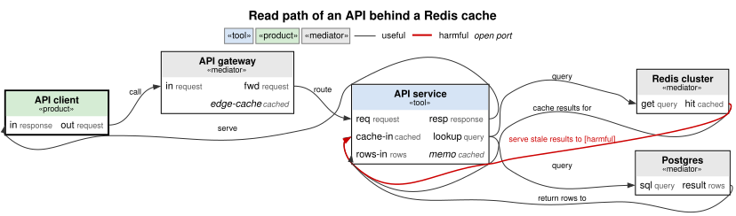
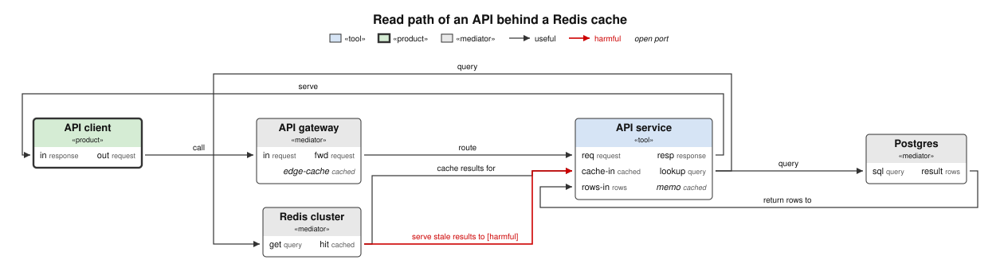

# triz-skill

An agent skill that applies TRIZ to real problems — products, services, processes, organizations,
markets, and technical systems — plus a deterministic MCP server so the agent can only cite
principles and matrix cells it has **looked up**, never ones it recalled.

Two parts, usable separately:

| Part | Path | What it is |
|---|---|---|
| `triz-innovation` skill | `skills/triz-innovation/` | `SKILL.md`, references, and the canonical JSON knowledge base |
| `triz` MCP server | `src/` | Read-only stdio MCP server over the same JSON |

## Why

An LLM asked for "the TRIZ principles for this contradiction" will produce plausible principle
numbers from memory. The matrix is a lookup table, not a reasoning step, so recall is the wrong
mechanism for it — and a wrong cell silently poisons everything downstream. This repo makes the
lookup deterministic and **fail-closed**: a blank or diagonal cell returns `covered: false` with a
pointer to the canonical reference, never a guess.

The skill itself is method, not vocabulary: frame → diagnose → model → synthesize → substantiate,
with the matrix used only where both sides of a contradiction credibly map to engineering
parameters.

## Install the skill

Copy or symlink `skills/triz-innovation/` into wherever your agent loads skills from — e.g.
`.claude/skills/`, `.agents/skills/`, `.codex/skills/`, or a `$SKILLS_DIR` your harness reads:

```bash
git clone https://github.com/sv/triz-skill.git
ln -s "$PWD/triz-skill/skills/triz-innovation" ~/.claude/skills/triz-innovation
```

Once the repo is listed on [skills.sh](https://skills.sh) the shorthand becomes
`npx skills add sv/triz-skill`.

The skill works standalone. The MCP server is what removes recall from the loop.

## Run the MCP server

Published package (preferred once released):

```bash
npx -y triz-mcp     # stdio server, no checkout needed
```

From a checkout:

```bash
pnpm install
pnpm start          # stdio server
pnpm test           # deterministic lookup regressions
pnpm typecheck
```

Register it (`.mcp.json` in this repo is a working example):

```json
{
  "mcpServers": {
    "triz": {
      "type": "stdio",
      "command": "npx",
      "args": ["tsx", "/path/to/triz-skill/src/server.ts"],
      "env": { "TRIZ_DATA_DIR": "/path/to/triz-skill/skills/triz-innovation/data" }
    }
  }
}
```

`TRIZ_DATA_DIR` is only needed when the server runs outside this repo's layout; otherwise the data
dir is resolved relative to the repo root and the server fails closed with a clear message if it is
missing.

### Hosted endpoint

`src/worker.ts` serves the same tools, except the optional `triz_graph` and `triz_purpose` and
`triz_export` format `svg`, as a Cloudflare Worker over stateless streamable HTTP (deploy with `npx wrangler deploy`; endpoints
`/mcp` and `/health`). It has no authentication and allows any origin (`Access-Control-Allow-Origin: *`) on purpose: it
is a stateless, read-only public utility with no storage bindings and no secrets, so any client
or web page may drive it. An operator who wants it private can check a token in `fetch` before
the MCP handler, list allowed origins instead of `*`, or put it behind Cloudflare Access or a
rate limit. Calling a hosted endpoint sends your model to whoever runs it; keep private models on
the local stdio server.

### Tool map

One line per workflow stage; the table below has one row per tool. What each model tool's
verdict means, and how to chain the tools, is in
[categorical-model.md](skills/triz-innovation/references/categorical-model.md); the theory behind
them, and exactly what is and is not claimed, is in [docs/theory-map.md](docs/theory-map.md).

| Stage | Tools | What they do |
|---|---|---|
| Lookup | `triz_parameter`, `triz_principle`, `triz_matrix`, `triz_matrix_multi`, `triz_resolve`, `triz_effects`, `triz_route`, `triz_tool_catalog`, `triz_evals` | Read the canonical data: parameters, principles, matrix cells, effects, the method router, and the eval suites |
| Model | `triz_build_model`, `triz_expand_hierarchy`, `triz_subsystem_contract`, `triz_function_model`, `triz_nine_windows`, `triz_abstraction`, `triz_export`, `triz_isomorphism`, `triz_behavior_refinement`, `triz_subsystem_summary` | Write the system as a typed function model, view it per level and time, relate coarse and detailed models, draw it |
| Check | `triz_function_model`, `triz_trim`, `triz_separate`, `triz_flow`, `triz_global_separation`, `triz_queue`, `triz_conservation` | Type errors, harm loops, ideality; trim candidates; whether a contradiction separates; flow bottlenecks |
| Transform | `triz_transform`, `triz_rule_apply`, `triz_trim_rewrite`, `triz_rewrite_pair`, `triz_rule_set` | Apply one typed move or a rewrite rule; the result type-checks or the call fails closed |
| Decide | `triz_behavior`, `triz_weakness`, `triz_dynamics`, `triz_feasibility`, `triz_adequacy`, `triz_implementations`, `triz_absorber_assignments`, `triz_synthesize` | From declared rows: is behaviour preserved, which concept is weakest, does it escalate, does it fit the budget |
| Certify | `triz_export` format `lean`; `certificate: true` on `triz_separate`, `triz_behavior`, `triz_dynamics`, `triz_weakness` | A Lean file stating the verdicts, checked locally by `scripts/certify.mjs` |
| Local | `triz_import_source`, `triz_review_import` | Draft models from local sources, then record explicit analyst confirmation |
| Optional | `triz_graph`, `triz_purpose` | A project's own network of problems (stdio server only; see below) |

### Tools

| Tool | Purpose |
|---|---|
| `triz_parameter` | Get one of the 39 engineering parameters with alternate labels and interpretation guidance; omit `id` to list all |
| `triz_knowledge` | List universal and domain knowledge packs, provenance, review status and explicit quantity parameters; all packs by default |
| `triz_principle` | Get one of the 40 inventive principles; omit `id` to list all |
| `triz_matrix` | Retrieve a canonical contradiction-matrix cell; blank cells fail closed |
| `triz_matrix_multi` | Every (improving × worsening) cell for multi-parameter conflicts, aggregated by recommendation frequency |
| `triz_resolve` | Retrieve a cell and expand its parameters and principles |
| `triz_tool_catalog` | List the routed TRIZ tool catalog, optionally by stage; entries name the MCP tools (`mcp_tools`) that carry out their method |
| `triz_effects` | Search all installed effects packs by function, category or typed quantity; optional domain/pack filters |
| `triz_effect_setup` | Build a typed model from registered effect ids and explicit finite/resource declarations; optionally generate a Lean typing certificate |
| `triz_route` | Select candidate tools by stage and observed problem signals |
| `triz_evals` | Return the neutral lookup and reasoning evaluation suites |
| `triz_build_model` | Build a typed model from explicitly rated component interactions, with stable ids, lints, and a bounded completeness report |
| `triz_expand_hierarchy` | Expand an inner model with explicit checked flow routes, media mappings, and opt-in budget, weight and contradiction policies |
| `triz_subsystem_contract` | Distinguish a declared interface summary from one checked against complete inner behavior and a supported resource mode |
| `triz_import_source` | Local only (stdio server and `triz` CLI): draft BOM, OpenAPI, Quint, Lean or Julia inputs with embedded source locations and pending review |
| `triz_review_import` | Local only (stdio server and `triz` CLI): confirm every pending rating and assumption while retaining source provenance |
| `triz_function_model` | Type-check a TRIZ function model (typed wiring diagram); harm loops, ideality per dimension, separation, baseline comparison with an isomorphism check; `mpv_weights` for a comparison over the main parameters of value |
| `triz_trim` | Screen trimming by MATRIZ rules A/B/C; carrier-typed absorbers, trimming problems, and level problems for excessive or insufficient functions |
| `triz_separate` | Decide whether a physical contradiction separates over space, time, condition, direction, or system level; optionally index it by one axis (Principle 15 along time); each separated pair gets suggested operations that could build the separation (hints, not verdicts) |
| `triz_transform` | Apply one typed move — a construction for one of 13 principles, an applied trim, or a rewrite; fails closed |
| `triz_rule_apply` | Double-pushout rewriting with rules as data: list a rule's matches, apply one; built-in evolution-line rules (mono → bi, self-adjusting feedback, changing the working field) and the uneven-development detector (the lagging subsystem) |
| `triz_nine_windows` | System-operator views: subsystem restriction, system, supersystem collapse, per time; transitions between times as checked `triz_transform` sequences; with declared rows, behaviour, weakness, and feasibility verdict changes between times, and flow candidates when flows are declared; returns the models transitions derive |
| `triz_export` | Export a model that type-checks as Graphviz DOT, a Mermaid flowchart, a self-contained SVG picture, an open hypergraph, or a Lean certificate of its verdicts |
| `triz_behavior` | Compose declared box behaviour into the input→deliverable relation (steady states, relational trace); with `compare_to` (and `box_map`), decide whether a concept such as a transform result preserves it; `trim` is shorthand; `joint_boxes` computes a coupled multi-box residual with projection-safety checks; one-hole `weakest_spec` can price missing producible rows using explicit `row_costs` |
| `triz_weakness` | Rank modelled concepts by the situations they admit, by inclusion, with incomparable pairs; counts second; acceptable values listed or derived from a threshold through the carrier's levels |
| `triz_dynamics` | Bounded runs of boxes with declared state (nondeterministic Mealy machines): escalation into an unsafe set with a shortest trace, invariance of a safe set, separation in time along one run; loops classified as bistable, trapped (inside the unsafe set), recurrent (meets it but can recover), or oscillating |
| `triz_feasibility` | Monotone co-design (Censi 2015): minimal resource vectors from declared box feasibility, by Kleene's ascent to the least fixpoint; with `trim`, decide whether the remaining boxes provide what the trim leaves them within budget, and the absorber's added resources; with carrier `levels`, the rows that disagree with declared behaviour |
| `triz_abstraction` | Check that a coarse model is an abstraction of a detailed one under a map of boxes, ports, and carriers: total, typed, every coarse function and harm loop the image of a detailed one; forgotten and hidden harms listed |
| `triz_flow` | Flow analysis over declared flow paths (boxes in series): per flow, bottleneck, accumulation, and leak candidates, and loops |
| `triz_graph` | Optional: analyse a project's OTSM Network of Problems (see below) |
| `triz_adequacy` | Require nonblocking and acceptable outputs at every required operating input |
| `triz_isomorphism` | Verify or search an annotation-preserving value/state/wiring bijection |
| `triz_behavior_refinement` | Check exact complete whole-model relation inclusion under an explicit interface/value map |
| `triz_subsystem_summary` | Compose an exact stateless boundary summary and report hidden harms |
| `triz_implementations` | Require one named implementation to meet behavior, resources and declared-harm constraints together |
| `triz_absorber_assignments` | Evaluate complete absorber assignments over every compatible output endpoint |
| `triz_synthesize` | Search fixed-wiring finite component libraries jointly across several holes |
| `triz_component_search` | Find components, chains or multi-input assemblies by searching catalogue instances and wiring against typed ports and optional finite property/resource contracts |
| `triz_component_catalogue` | Get the shared general catalogue; reusable libraries combine across domains through explicit type bindings |
| `triz_effect_chains` | Search bounded typed effect chains from explicit resources; hypotheses require substantiation |
| `triz_lifecycle` | Solve declared maintenance policies and holding costs; ambiguous optimal-policy occupancy remains undecided |
| `triz_bond_graph` | Check structural effort/flow causality, forced derivative storage and equation dependencies |
| `triz_effect_insert` | Insert a discovered effect chain into an existing model with explicit bindings and a replayable rewrite |
| `triz_global_separation` | Find one assignment satisfying every allowed overlapping local relation |
| `triz_queue` | Compile and check an explicitly scheduled finite queue for overflow |
| `triz_conservation` | Check declared extensive consumption or shared intensive minimum levels |
| `triz_rule_set` | Check a sufficient termination measure for a validated named rule subset |
| `triz_rewrite_pair` | Check whether two named rewrites commute in their two orders |
| `triz_trim_rewrite` | Return explicit absorber-aware trim data with checked structural replay |
| `triz_purpose` | Optional: inspect the invariant, purpose gate, and separation check of one graph node |

For local source import, including exports from instantiated ModelingToolkit and Agents.jl models,
see [Importing models](docs/importing-models.md). Imported models remain drafts through the builder
and are refused by analysis until explicitly reviewed.

`triz_behavior` can specify several unknown boxes jointly: use `weakest_spec` with `joint_boxes`
and a target. The result keeps coupling explicit and checks whether its per-box projections are
safe. See [Joint weakest specification](skills/triz-innovation/references/categorical-model.md#joint-weakest-specification).

## Command line

The package also installs `triz`, which runs the same tools without an MCP client, for scripts
and agents with a shell. It validates arguments exactly as the server does and prints only JSON
on stdout:

```bash
triz list                                       # one line per tool; --json for a JSON array
triz schema triz_behavior                       # the description and input JSON Schema, as JSON
echo '{"improving": 9, "worsening": 14}' | triz call triz_matrix    # or: triz call <tool> args.json
```

`triz call` exits 0 with a result, 1 when the result has `ok: false` (its `issues` and hints are
still on stdout), and 2 on a usage error or arguments that fail the tool's schema (the issues as
JSON on stderr); `--pretty` indents the output. Without a global install, run
`npx -y -p triz-mcp triz …`; from a checkout, `node --import tsx src/cli.ts …`, or
`node dist/cli.js …` after `pnpm build`. `triz_graph` and `triz_purpose` read `TRIZ_GRAPH` and
`TRIZ_REGISTRY`, as on the server.

## Function models as typed data

The eight-workstream assurance extension adds whole-model behavior, operational adequacy,
input-bound Lean certificates, semantic isomorphism/refinement, joint implementation and finite
synthesis contracts, global overlapping-constraint checks, finite queue/conservation adapters,
and restricted rewrite analysis. See [implemented scope and tools](docs/categorical-assurance.md).
[Future work and acceptance criteria](docs/categorical-future-plan.md) and
[literature references](theory/REFERENCES.md) are kept in separate files; these bounded capabilities do not close every research exclusion.


`triz_function_model`, `triz_trim`, and `triz_separate` run deterministic checks over a function
model written as an open wiring diagram, defined by
[`function-model.schema.json`](skills/triz-innovation/schemas/function-model.schema.json):

- boxes are components with typed ports;
- wires are functions rated useful, insufficient, excessive, or harmful;
- carriers name what flows and in what unit;
- flows, optionally, list the boxes a carrier passes through in series, in order.

Any dangling, mis-directed, or mistyped wire fails closed. The checks cover:

- harm loops;
- trimming by rules A/B/C;
- ideality compared per dimension and never summed;
- physical-contradiction separation as a gluing problem.

Every `ok: false` result keeps its `errors` and adds `issues`: per error a stable kebab-case
`code`, a JSON `path` into the call's arguments (such as `$.model.wires[2].carrier`), and a
`hint` with a concrete fix, so an agent can correct its input from the output alone. Common
slips get a pointed hint, such as a whole `triz_rule_apply` listing entry passed as `match`.
`triz_function_model`, `triz_trim`, and `triz_behavior` also return `warnings`: lints such as an
excessive rating on a loss like a pressure drop, which never change a verdict. That lint guesses
a loss from words unless the carrier declares `loss`, so a renaming can move it.
[error-codes.md](skills/triz-innovation/references/error-codes.md) tabulates every code.

Every loop and absorber they return is a hypothesis to substantiate. `triz_transform` applies
typed moves. Each returns a model that type-checks, or fails closed:

- constructions for the 13 principles whose looked-up text describes a structural move, such
  as Segmentation, Merging, Inversion, Feedback, and Intermediary; the theory map
  classifies all 40 and says why the others are parametric or analogies;
- an applied trim;
- a raw rewrite.

`triz_rule_apply` takes a rule as data, a span L ← K → R of patterns
([`rule.schema.json`](skills/triz-innovation/schemas/rule.schema.json)). It lists the rule's
matches in a model, then applies one by double pushout after checking the no-identification and
no-dangling conditions. Three built-in rules encode evolution lines whose text describes a
structural move: mono → bi, self-adjusting feedback, and changing the working field (the same
function on another carrier, with the change recorded). The uneven-development line is a
detector instead: it names the lagging subsystem, a box of the largest harm-loop region that is on
a binding feasibility dimension or limits a deliverable.

Functions record who acts on whom, not which boxes sit in series along a flow: two valves in a
line both act on the water, not on each other. A model can declare `flows`, each an ordered path
of boxes with a carrier. `triz_flow` reports per flow its bottleneck candidates (resistance-like
functions acting on the flow), accumulation candidates (flows converging, or ending inside the
system), leaks, and loops. Principle 5's `merge` treats boxes consecutive on a flow as adjacent,
and every construction carries the flows along.

When boxes declare behaviour (finite carrier `values` and relation rows), `triz_behavior`
decides a concept against a baseline instead of only screening it: `preserved`, `changed` with
a counterexample input, or `undecided` (boxes that need behaviour, or no steady state in either
model). The concept can be a trim or any `triz_transform` result; a segment's `boxMap` maps its
parts back. Segmentation gives each part its projection of the box's relation when that relation
is the product of the projections, and suggests the finest partition of the box's ports for
which it is; Intermediary's mediator can declare an identity relation.
The semantics is steady state; it says nothing about dynamics. With `weakest_spec`, it gives the
weakest specification for the one box without behaviour, such as an absorber: every row that
keeps the relation inside the target. The verdict is `spec` when that specification also covers
the target, and `impossible` when no behaviour of the box can. When the box declares the rows it
can physically produce (`producible`), the specification is cut down to them, and a target only
unproducible rows reach is `impossible` with reason `infeasible`, naming those rows. With two
boxes without behaviour, such as an absorber and a new mediator, it gives the maximal pairs of
relations for them that cover the target; several such pairs are incomparable, so there may be
no weakest one. `triz_weakness` ranks modelled
concepts by the situations they admit (references/weakness.md).

When boxes declare feasibility (minimal rows of levels provided against levels required and
operating cost), `triz_feasibility` finds the minimal resource vectors by Kleene's ascent to the
least fixpoint, loops included, and judges them against the budget: `feasible`, `infeasible`
(over budget with the binding dimension, or a level no row provides), or `undecided`. With
`trim`, it decides whether the remaining boxes provide what the trim leaves them within budget,
and reports each absorber's added resources. No polynomial bound is claimed; past its caps the
call fails closed.

When boxes declare state (`state`, `initial`, and `transition` rows), `triz_dynamics` explores
every run up to a horizon. It decides whether a harm loop escalates into an unsafe set, with a
shortest trace, and whether a safe set is invariant. It also decides whether one run meets
time-separated demands within their windows. It classifies the loops' long-run behaviour as
bistable, trapped (a closed component inside the unsafe set), recurrent (one that meets it and
can recover), or oscillating. Only finite, discrete dynamics are covered.

The models link to each other. A carrier may declare `levels`, thresholds that read numeric
feasibility amounts as behaviour values (from 2500 N, `supported`); `triz_feasibility` then
reports each feasibility row whose amounts disagree with the box's behaviour rows, and
`triz_weakness` takes its acceptable set from a threshold (`at_least`, `below`) instead of a
hand-written list. `triz_abstraction` checks that a coarse model (few boxes, behaviour) is an
abstraction of a detailed one (many boxes, costs) under a map of boxes, ports, and carriers:
total, typed, every coarse function the image of a detailed one of its polarity class, and
every coarse harm loop the image of a detailed loop. `triz_function_model` takes `mpv_weights`
to compare a concept with its baseline over the main parameters of value only, with explicit
weights. When the 9-windows snapshots declare rows, each time carries its behaviour and
feasibility verdicts, and each change between times says how they move.

`triz_nine_windows` builds system-operator views, and `triz_export` draws a model or encodes it
as an open hypergraph. Format `dot` draws each box with its «role» and its typed ports, inputs
left and outputs right, rates each function by line style and colour, and adds a legend; render
it with `dot -Tsvg`. Format `mermaid` renders as is in GitHub and GitLab markdown and in many
chat clients; Mermaid has no ports, so each edge names its ports and carrier instead.



Format `svg` returns the picture itself, with no Graphviz needed. The server lays the model out
with [elkjs](https://github.com/kieler/elkjs): boxes left to right, ports fixed on the box sides,
and orthogonal edges. It then writes a self-contained SVG with the same conventions as `dot`.
Hover a box or edge to see its id. Text widths are estimated from Helvetica and Arial metrics,
so a much wider font may run past a box. elkjs (about 1.6 MB) is an optional dependency: it is
installed with `triz-mcp` unless optional dependencies are omitted (`--omit=optional`), and
without it the format answers `ok: false` with `format-unavailable`. The hosted Worker does not
offer the format. elkjs would more than double the script, it does not start on workerd as
published, and a first layout costs more CPU than a Free-plan request allows (see
`src/worker.ts`).


 Given `compare_to`, `triz_function_model` also reports whether the two
models share a wiring shape. Each verdict names in `basis` the theorem in `theory/` it relies
on; a test checks that every cited name is a theorem there. Typing, harm-loop witness, and
separation verdicts can also be certified per instance: `triz_export` format `lean` (or
`triz_separate` with `certificate: true`) writes a Lean file that states them about the model
and proves them, and `node scripts/certify.mjs` checks it with local Lean. Only explicit
`--remote` sends the certificate and its model data to the AXLE service. `triz_behavior`, `triz_dynamics` and `triz_weakness` with `certificate: true` cover
supported finite behavior comparisons, reachable escalation/state-only inductive safety, and
strict, equal or incomparable concept pairs. Manifests bind the source request and scope;
`node scripts/certify.mjs --local --tamper --request request.json result.lean` checks source/table
correspondence and the listed proofs. Unsupported cases and caps return an explicit reason.
Nothing is extracted from Lean. The structured verdicts of the
checks are label-blind: renaming ids or
changing the domain does not change them. Property tests check this, with the exclusions listed
in the theory map. That shows the kernel reads only the wiring shape, not that solutions
transfer between domains.
[docs/theory-map.md](docs/theory-map.md#what-is-not-claimed) states exactly
what is and is not claimed. `examples/function-models/` holds a physical, a business, and two
software models. One software model has the physical model's wiring shape. Three copies of
the physical model declare box behaviour, box feasibility, and a shaft temperature, so their
trims can be decided and their heat loop's escalation classified.

Behavior contracts prune incompatible multi-port correlations before enumeration, and resource
support witnesses expose their activation order. The [mathematical integration map](docs/math-connections.md#integrated-theorem-search-results)
explains the checked foundations for general component synthesis and the remaining adapters.
The [mixed-system guide](docs/mixed-system-analysis.md) includes a runnable hardware, software
and service-provider example and explains multidimensional constraints and optimization scope.

`theory/` is a Lean 4 / Mathlib package that states and proves the facts the checks rely on,
with no `sorry`:

- gluing iff every cell is satisfiable;
- an edge in a strongly connected region lies on a cycle;
- the componentwise order is not total;
- typing survives relabelling, deletion under the no-dangling condition, gluing, and
  re-attachment to a same-carrier port;
- restriction composes, and makes typed diagrams a presheaf on the poset of box sets;
- restriction commutes with every rewrite step restricted to the subsystem, so the subsystem
  and system rows of the 9 windows, with two steps, form a functor from time × (box sets)ᵒᵖ to
  sets;
- series composition of relations (Mathlib's `Relation.Comp`) is monotone, and the relational
  trace is monotone and yanks a swap to the identity;
- declared behaviour has a compositional steady-state semantics (`theory/Semantics.lean`):
  gluing open diagrams in series, with the interface fully exposed, composes their external
  relations; a disjoint union gives the product; feedback gives the relational trace; widening a
  box widens the relation. Diagrams up to their relations form a category with a faithful
  functor to `RelCat`. `externalBehavior` is checked against a brute-force transcription of this
  semantics on seeded random models and the examples, not extracted from it;
- a relation is the product of its projections iff it is a product at all, for two parts and
  for any family of parts, and for two parts iff it is a rectangle: rows (a, b) and (c, d) give
  the row (a, d);
- series composition and the trace preserve unions, so for one unknown box the rows that keep a
  composite inside a target form the weakest specification (a Galois connection), and the target
  is reachable iff that specification's composite covers it; within the rows the box can
  produce, iff the specification cut down to them covers it, and a relation that reaches the
  target holds, for each target pair, a row of the specification that delivers it; for two
  unknown boxes the maximal safe pairs of relations are the formal concepts of the safe row
  pairs, and the target is reachable iff one of them covers it;
- concepts are ordered by inclusion of the situations they admit, and a strict inclusion gives a
  strictly larger count;
- reachability within n steps is an existential over traces, a counterexample trace is sound, a
  layer that adds nothing completes the reachable set, reachability is monotone in the
  transition rows, a closed set holds every run that enters it, from a closed set inside the
  unsafe set every reachable state is unsafe, and without a fixed point every return takes two
  steps or more;
- series, parallel, and feedback composition keep feasibility monotone, Kleene's ascent reaches
  the least fixpoint of a finite lattice, and the co-design fixpoint is the upward closure of the
  feasible configurations.

Verdicts cite only the statements they use exactly; the
[theory map](docs/theory-map.md#theorem-inventory) marks the others as never cited, and why.

`theory/Witnesses.lean` checks that none of the typing, restriction, rewrite,
behaviour-monotonicity, residual, weakness, co-design, or dynamics lemmas is vacuous. For each, a
concrete diagram, relation, or step relation meets all its hypotheses, and a counterexample shows
each hypothesis is needed. `theory/SemanticsWitnesses.lean` does the same for the compositional
semantics, except for the part of a diagram (`sub`): there only the extension hypothesis has a
counterexample, and the interface and locality hypotheses (`hI`, `hO`, `hloc`) have none.

Trimming is decided only for models that declare behaviour, by `triz_behavior`'s finite
relational check, and its verdict depends on the absorber chosen. `theory/` does not state
trimming as a Kan extension; the theory map says why.

```bash
pnpm schema                       # regenerate the JSON Schema from src/act.ts
pnpm lean:setup                   # theory/.lake/packages: cloned from another checkout, or fetched
(cd theory && lake build --wfail)
node scripts/certify.mjs --local --tamper theory/Certificates/*.lean   # tampered copies must fail
TRIZ_SKIP_LEAN=1 pnpm test        # skip the Lean-backed tests even where theory/ is built
TRIZ_REQUIRE_LEAN=1 TRIZ_LEAN_JOBS=3 node --import tsx --test tests/act-cert.test.ts   # as Lean CI runs them
```

`pnpm lean:setup` (`scripts/lean-setup.mjs`) sets up `theory/.lake/packages`: Mathlib and the
packages it requires, with the prebuilt oleans of the Mathlib modules the theory imports. When the
directory is missing, it looks for another worktree or the main checkout of this repository
(`git worktree list`) whose `theory/lake-manifest.json` and `theory/lean-toolchain` are
byte-identical, and clones its packages copy-on-write (`cp -cpR` on macOS APFS, `cp -pR
--reflink=auto` on Linux), so a new worktree downloads nothing and shares the blocks on disk.
Without one, or when an imported module still has no olean, it runs `lake exe cache get` with the
theory's Mathlib imports, the same list as Lean CI (`node scripts/lean-setup.mjs
--print-imports`). That command is its only network access. It prints what it did; then build.

Once `theory/` is built, `pnpm test` also runs the Lean-backed certificate tests. Each Lean process
they start loads the theory's whole import closure (about 2.5 GiB of Lean and Mathlib, about
1.5 GB resident). The tests run one at a time, and a test starts its processes one after another;
`TRIZ_LEAN_JOBS=N` runs N tests at once. The theory is built once before them (`lake build
CategoricalTriz`), and the tests only run `lake env lean`, so no two builds contend for Lake's
lock. `TRIZ_SKIP_LEAN=1` skips them.
Lean CI runs only the test files that declare a `leanTest`, with `TRIZ_REQUIRE_LEAN=1`, which fails
when Lean is missing, whatever `TRIZ_SKIP_LEAN` says, and `TRIZ_LEAN_JOBS=3`; the CI workflow runs
every other test. `certify.mjs` checks all its files and their tampered copies in one Lean process.

## Optional: your own network of problems

`triz_graph` and `triz_purpose` reason over a *project* contradiction graph — they ship with no
data. The graph is an OTSM Network of Problems with a DIKWP purpose layer:

- nodes are open contradictions; edges are `couples`, `blocks`, or `dissolves`;
- the **core conflict** is the node with the most outgoing `dissolves` edges — resolving it removes
  the most others (the Theory-of-Constraints step);
- a node may carry a `contradiction` in the function-model schema's PhysicalContradiction form.
  `triz_graph` checks it and reports `irreducible`, `separable`, `no-contradiction`, or
  `invalid`; an invalid one fails closed for that node only, with its errors.
  - Ties on `dissolves` go first to irreducible nodes, then to unmodelled or invalid nodes, then
    to separable nodes, and last to nodes that are not contradictions.
  - `dissolves` stays the primary key. A node that already separates keeps its place but is
    flagged, because separation already gives it a resolution route;
- each node's `purpose` names the invariant it serves, and counts as **secured** only when a
  `verified_by` record exists on the node or on a linked registry entry. No verifier, no gate — it
  fails closed.

`examples/problem-graph.json` and `examples/triz-registry.json` show the expected shape:

```bash
TRIZ_GRAPH=examples/problem-graph.json \
TRIZ_REGISTRY=examples/triz-registry.json \
npx tsx scripts/graph-report.mjs report.md
```

Point `TRIZ_GRAPH` / `TRIZ_REGISTRY` at your own files, or place them at `data/problem-graph.json`
and `data/triz-registry.json`.

## Evaluations

`skills/triz-innovation/data/` carries three suites:

- `evals.json` — hard lookup assertions (run by `pnpm test`) plus synthetic reasoning cases;
- `published-case-evals.json` — six problems reconstructed from CC BY MATRIZ publications. Solver
  prompts contain only pre-solution facts; reported diagnoses and outcomes stay in judge-only
  fields and are never returned by `triz_evals`.

Scoring does not require reproducing the published solution — a causally stronger, testable
alternative earns full credit.

### Running the suites (bring your own key)

The suites ship as data; nothing calls an LLM by default. `scripts/run-evals.mjs` runs them
against any OpenAI-compatible endpoint and is **fail-closed on a key** — without
`TRIZ_EVAL_API_KEY` (or `OPENAI_API_KEY`) it exits before any network call. CI exercises it in
`--dry-run` mode only, which is offline and keyless. Results land in `evals/results/` (gitignored)
as JSON plus a markdown report:

```bash
pnpm evals -- --suite no-recall --limit 40        # matrix-recall citation benchmark
pnpm evals -- --suite reasoning                   # synthetic cross-domain cases, LLM judge
pnpm evals -- --suite published --variant solver  # blinded MATRIZ cases, structured variant
pnpm evals -- --dry-run --suite published         # plan a run: no key, no network
```

`TRIZ_EVAL_BASE_URL` and `TRIZ_EVAL_MODEL` select the endpoint and model (any
OpenAI-compatible API). `no-recall` is the benchmark that justifies the server: a model asked
for matrix cells from memory is scored against the canonical table, and fabricated citations are
counted. With the server in the loop, the same citations are lookups — fabrication is zero by
construction.

## Data provenance and licensing

- The 39 parameters, 40 principles, and the core tool catalog are classical TRIZ vocabulary;
  the effects starter database (78 entries, all with conditional typings) contains repository-authored summaries of physics,
  chemistry and geometry. See the [catalogue audit](skills/triz-innovation/references/effects-audit.md)
  for corrections, additions, references and evidence gaps.
- [Knowledge packs](skills/triz-innovation/references/knowledge-packs.md) separate universal
  measurement vocabulary from domain quantities and effects. All installed packs are used by
  default. Expert contributions add versioned JSON packs with attributed review status;
  `pnpm knowledge` validates their union and updates hosted imports. Canonical matrix parameters
  remain the original 39.
- Eight shared interface families factor 22 named cases into 14 signatures, giving 70 independently
  declared interfaces while retaining all 78 searchable entries and their case-specific evidence.
  Serial recipes expand into checked constituent models through `triz_effect_setup`; they need
  no new opaque generator. Raw pack consumers should use `compileKnowledge` to resolve contracts.
- `triz_knowledge` reports field groups separately from the 69 response and nine mechanism
  entries; these are modeling roles, not counts of independent physical laws.
  `pnpm example:effects-products` checks selected contracts against a real voice-coil stage and
  two patent disclosures, preserving discovery and rejecting unsupported decompositions.
  See the [validation scope](docs/effects-evidence.md#product-and-patent-validation).
  `pnpm example:effects-recent-patents` checks nine 2025–2026 publications, four added response
  clauses, further interface sharing, and explicit state/probability limitations.
- The [classical parameter audit](skills/triz-innovation/references/parameters-audit.md) retains
  every matrix id, clarifies nearby categories and normalizes Force at id 10 with the former
  wording retained as an alias. Runtime and schema checks protect the closed 1–39 vocabulary.
- `matrix.json` was imported from a machine-readable workbook. The underlying table is Altshuller's
  and widely republished. To regenerate the file from a source of your own choosing:

  ```bash
  npx tsx scripts/import-matrix.mjs <url|file.csv|file.json> [--format csv|json]
  ```

- Published case benchmarks are concise attributed paraphrases of CC BY publications; sources,
  authors, and pages are recorded per case in `published-case-evals.json`.
- The code in this repository is MIT licensed (`LICENSE`). That license covers the code and the
  original prose, not third-party data noted above.


## Roadmap

The ranked backlog of the categorical-model work — certificates for the verdicts that have
none, properties to promote from tested to proved, and the larger categorical closures — lives
in [docs/FUTURE-PLANS.md](docs/FUTURE-PLANS.md), with what each item closes in the theory map's
"What is not claimed". The acceptance criteria of the assurance
workstreams are in [docs/categorical-future-plan.md](docs/categorical-future-plan.md).

## Publishing and distribution

The full runbook — npm release flow, the MCP Registry PR, Smithery/Glama/PulseMCP, skill
registries (skills.sh, anthropics/skills, OpenAI), and promotion — lives in
[docs/PUBLISHING.md](docs/PUBLISHING.md).

## Registries

**MCP Registry.** [`server.json`](server.json) holds the prepared entry (name
`io.github.sv/triz`) for the official registry at
[registry.modelcontextprotocol.io](https://registry.modelcontextprotocol.io). Listing goes
through the official `mcp-publisher` CLI — not a PR: publish the npm package first (the registry
verifies the `mcpName` field inside the published package.json), then
`mcp-publisher login github` (device flow) and `mcp-publisher publish`. Full steps in
[docs/PUBLISHING.md](docs/PUBLISHING.md).

**npm.** Publish to the public npm registry (`npm publish`) so `npx -y triz-mcp` works without a
checkout. GitHub Packages also hosts npm packages (`npm.pkg.github.com`), but it requires
authentication even to install public packages, so it suits private or org-internal distribution
— not a public CLI.
