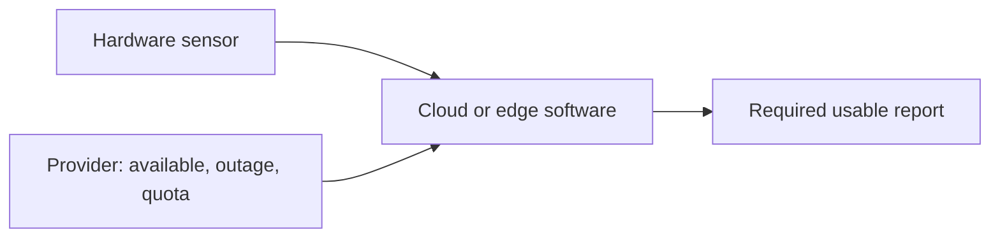

# Hardware, software and ecosystem analysis

The engine can analyze a mixed system when interfaces, behavior, resource modes and operating
conditions have explicit finite declarations. Domain tags do not determine compatibility:
hardware samples, software messages and provider entitlements connect through their declared
carrier types and values. Names do not supply missing semantics.

## One specification, several objectives

A specification includes hard requirements and ordered objectives. A budget is an ordinary
hard requirement on the complete design, alongside acceptable outputs, safety, interfaces and
allowed harms. Cost can be a vector such as money, energy and maintenance. A coordinate may
have both an upper bound and a minimization objective.

Conceptually, choose components, wiring, operating modes and lifecycle policy together; keep
designs satisfying the hard requirements, then return the Pareto frontier of the declared
objective vector. Dominance means no worse on every objective and better on at least one.
Weights are explicit preferences. Separate per-axis optima or weighted solves do not enumerate
a general Pareto frontier.

Each property needs a declared order and composition law. Current resource cost axes add
across selected rows; putting latency in that map asserts additive latency. Parallel latency,
peak memory, correlated availability and privacy obligations need their own valid semantics.
Representing a property by a number does not make these aggregation rules interchangeable.

**Current API:** finite contracts check behavior, adequacy, harms and a multidimensional
`contract.budget` jointly on the same assembly and resource mode. Resource feasibility keeps
Pareto-minimal resource vectors. Component discovery ranks satisfying assemblies by component
count and construction order. Lifecycle solves individual cost dimensions or an explicitly
weighted objective. A joint objective-vector/Pareto optimizer across assemblies, modes and
policies remains future work. This guide introduces no new request fields.

## Runnable example

Run from the repository root after installing dependencies:

```sh
node --import tsx examples/assurance/mixed-system.mjs
```

The [example](../examples/assurance/mixed-system.mjs) executes shared tool handlers and asserts
the results. All behavior and costs are synthetic assumptions, with no measured hardware,
software or provider data.



The envelope assumes the sensor supplies one sample. Cloud software produces a usable report
only when the provider is available. Edge software is declared capable of local processing in
all three provider conditions. Each complete alternative has one explicit resource mode.

| Check | Observed result |
|---|---|
| Cloud adequacy | Inadequate: outage and quota inputs produce an unacceptable report |
| Edge adequacy | Adequate across all three inputs |
| Joint implementation contract | Only edge meets behavior, adequacy, harm and resource constraints together |
| Component discovery | Checks both templates and automatically finds the edge assembly |
| Money limit reduced from 8 to 4 | No satisfying assembly in this two-entry, one-component space |

Declared complete `(money, energy, maintenance)` costs are `(3, 2, 3)` for cloud and `(6, 4, 1)`
for edge. Broad limits are `(8, 5, 5)`. Cloud's lower money/energy costs do not compensate for
failing the hard requirement of a usable report in every required condition. With the tighter
money limit, neither design satisfies the specification. This concerns the bounded catalogue;
other architectures remain possible.

Each adequacy check explores 15 search nodes. Discovery checks two assemblies and reports
747 work units for these declarations. These small-fixture counters are not a throughput or
scalability benchmark. Changing the overall domain label to software or business preserves
the selected assembly, which the example also checks.

## Analysis and improvement scope

| Layer | Useful declarations and checks | Evidence still required |
|---|---|---|
| Hardware | Typed interfaces, SI dimensions, finite operating/failure rows, resource thresholds, structural energy relations | Measurements or justified abstractions for physical response, efficiency, startup, stability and failure rates |
| Software | Finite input/output relations, state transitions, queues, resource modes and protocol assumptions | Correspondence with running code, timing/scheduler assumptions and representative workloads |
| Ecosystem | Provider states, quotas, supplier alternatives, declared harms and joint operating conditions | Evidence for contracts, rates, correlated outages and changing rules; strategic behavior is not inferred |
| Whole system | Counterexample conditions, coupled adequacy/resource checks, bounded replacement/assembly discovery and supported finite certificates | Trustworthy cross-layer models and complete operating envelopes; prose goals alone do not become checked properties |

The example's improvement crosses layers: a provider dependency motivates a different software
deployment with different declared hardware/resource costs. Other supplied architectures can
be compared through the same mechanism. Undeclared capabilities and provider choices are not
inferred from component names.

The example checks finite steady-state behavior. Explicit transition models can additionally
be analyzed, but hardware time scales, asynchronous software schedules and provider decision
epochs must be reconciled in those declarations. No coupled product MDP is inferred from the
architecture. Probabilities and shared outage correlations must be supplied; the engine does
not estimate them or predict strategic actor responses.

Performance depends on variable/domain sizes, scope overlap, feedback, state/action products,
catalogue entries and component bounds. Mixed domain labels add no search dimension. Unary
propagation and overlap-aware semijoins remove impossible rows early. Dense cyclic correlations
and large catalogues can still require exponential enumeration; caps return explicit
uncertainty. Hierarchical contracts and checked summaries can reduce scope under their stated
assumptions. Arbitrary abstraction does not automatically preserve behavior, cost or lifecycle
properties.

Next extensions are explicit joint objective orders/aggregation, Pareto search across
assembly/mode/policy choices, a checked constructive acyclic solver, and initial-state-aware
lifecycle optimization. Guarded feedback and physical/CSLib adapters need the bridge proofs
listed in the [mathematical integration map](math-connections.md#integrated-theorem-search-results).
